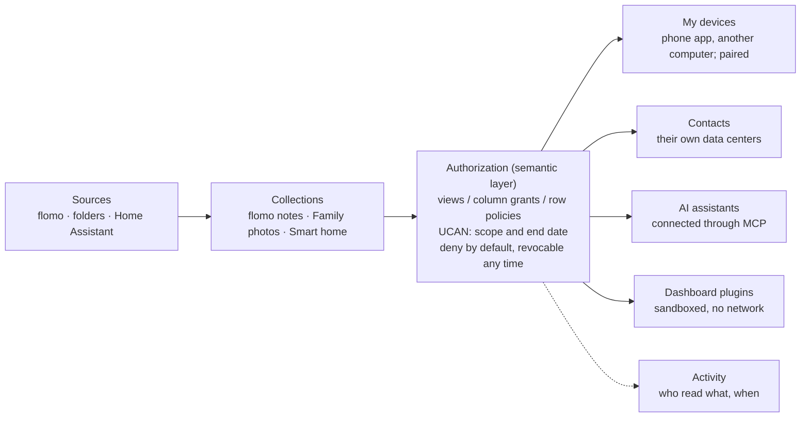

# Oikome Apps PRD

> Drafted on 2026-11-01 in Claude Docs. Since 2026-11-04 it lives in the repository and changes together with [`architecture.md`](architecture.md) and [`prototype/`](prototype/prototype.html). Where they disagree, the architecture decides technical facts and the prototype decides the interface.

## Background and Problem

Conclusion: the apps face users only. They are "my data center", and Home is a dashboard that plugins can add cards to. There are no operations or developer pages; those stay in the command line. For now the focus is a personal private data center; member roles come later.

- **The state when the work began (2026-11-01):** `web/` was the browser node of phase 3.2, wrapping `oikome-wasm` with duckdb-wasm, IndexedDB and WebRTC. The page showed only a DID, and SQL had to be typed into the browser's developer console. A Full Node could be managed only with the `oikome sql` command line; there was no web entry point. The web app has since reached M2 (see Milestones).
- **Problem:** Oikome is meant as a private data center for individuals, families and small teams, but at the time only developers who write SQL and understand Spaces and UCANs could use it. Owners could not easily browse their own data or look at it on their phones, and friends could not safely receive a share.
- **Why not an operations console:** turning CREATE SPACE and ISSUE UCAN into forms only changes how they are typed; users still have to understand the concepts underneath. Ordinary users care about where their notes, photos and home sensor readings are, who can see them, and what AI can see.
- **What this PRD answers:** who the apps are for, what they do, how they look, how plugins plug in, and what the back end needs for it.

## Target Users and Core Scenarios

For now the focus is a personal private data center. The apps serve only the data's owner, on their own computer and phone. Friends use them only when receiving a share. Family members (member roles) come later. Documentation and debugging tools for plugin developers are not in the apps.

| User | Who | What they do most | How they get in |
| --- | --- | --- | --- |
| Data owner (primary) | Whoever installed Oikome, with an always-on computer or NAS; may not know databases | Connect apps, browse and search their data, install dashboard plugins, control what AI can see, share with friends | A browser on the computer opens the local web page; a phone with the Oikome app can also look once paired by QR code |
| Friend | Has an Oikome data center of their own | Accepts shares and sees the shared collections in their own data center | Adds the invite code on their own Sharing page and accepts it |
| Family member (later) | Not technical; only wants to look and find | Sees the dashboards and collections the owner granted them | Member roles are designed later |

Core scenarios:

1. The owner installs Oikome on a NAS, imports flomo notes within ten minutes, and a "Recent notes" card appears on Home.
2. The owner installs the Oikome app on a phone and scans the QR code on the computer's web page. The phone becomes another of the owner's devices for leafing through notes and albums around the house, with no account to register.
3. With the Home Assistant source and the "Smart home" dashboard plugin installed, Home shows each room's temperature and humidity and this week's power use.
4. The owner finds that an AI assistant can see all notes and, under MCP Access, limits it to "Public notes".
5. A "Reading list" a friend shared appears among the collections and disappears when the friend takes it back.
6. Ten years of photos on the NAS can be browsed and searched in Oikome where they are, without importing them. The owner picks a few edited ones, saves them to a folder on a cloud drive sorted by year and month, and turns them into a portfolio to share with friends.

## Product Principles

1. **Talk about data, not engines.** The interface never shows Space, Location, UCAN, DID or SQL. Build only what users need; no operations or developer pages, which stay in the command line.
2. **Who can see what, at a glance.** Every collection shows who is looking, what they can see and when it ends, and can be taken back in one step. Friends, my devices, AI assistants and plugins share one permissions interface.
3. **Deny by default.** A newly installed plugin, connected AI or paired device sees nothing until the owner grants it, as in principle 5 of the architecture. A public share is the owner's explicit grant to anyone; without one, strangers see nothing.
4. **Data stays home.** The apps and plugins never send data to third parties, and plugins cannot reach the network. Data kept on a cloud drive is encrypted on this computer by default. When saving files to a cloud drive, the owner may choose not to encrypt them so other apps can open them; the interface says the drive's provider can then see them. Data leaves home in only two ways: the owner shares or publishes it, or the owner saves it to a place outside home.
5. **One set of screens, several clients.** Screens live in `packages/screens`; the web app uses them now, and the desktop and phone apps will reuse them. A phone pairs through the phone app, not a phone browser: a browser needs an HTTPS page, which the local server cannot give it.
6. **Strings are translatable; user data is not translated.** UI text is made of translatable strings, never hard-coded in components. The apps have the prototype's nine interface languages (English US and UK, German, French, Russian, Japanese, Korean, Simplified and Traditional Chinese, M8): each device picks its own, in Settings or on the first screen, and starts in the browser's language, with US or UK English by its region or time zone. Dates and numbers are written the language's way, and the examples a new data center starts with are written in the language picked at first run. Collection names, notes, people's names and room names are the user's data and are not translated.

## Concepts

The interface uses the words on the left; underneath are the mechanisms in the middle. No parallel set of concepts is added.

| In the interface | In the system | Notes |
| --- | --- | --- |
| Collection | Space | A body of data on one subject, such as "flomo notes", "Family photos" or "Smart home" |
| Place (this computer is Local) | Storage / Location | This computer (Local), a NAS (3.4a), cloud drives (from 3.4b, with files and names encrypted on this computer; 3.4c Google Drive and Dropbox through their APIs, signed in to on their pages; 3.4d Baidu Netdisk), object storage on RustFS, the one supported (3.4e, encrypted by default; the bucket must exist). Files already on a place can be viewed in place (3.9). A collection a source fills goes on Local by default; another place is asked about first, and this computer keeps the working copy and sends a copy there after every sync |
| Source | Connector | Pulls data in from an app or a folder, with sync status; can be paused (3.5) |
| Keeping files in place (Add Files › Keep in Place) | An in-place Space (`InPlace` Location) + an index on this computer | Selected files or whole folders already on a storage or drive are viewed and queried where they are, not copied; one collection can reference files from several folders without exposing unselected siblings. The index and thumbnails stay on this computer and can be rebuilt (3.9) |
| Save To | Save rules (node configuration) | The owner picks the target place, folder and naming rule, once or continuously; the target is plain files or a new collection; only files Oikome wrote itself are changed (3.10) |
| Portfolio | How a saved Space is presented | Order, cover, title and captions, shared with the collection (3.10) |
| Contact | The other side's DID + a local name | People can't read a DID; the name is kept only on this computer |
| Share | UCAN + view / column grants / row policies | "Share only public notes" = one view plus one UCAN |
| Stop sharing | REVOKE UCAN | The other side's next request is refused |
| View live / Keep a copy | MODE = 'query' / 'subscribe' | Sharing a transactional collection publishes a snapshot automatically (PUBLISH SPACE), unseen by the user |
| My devices | A paired device + the UCAN issued to it | The entry is Add a Device; a phone scans a code, another computer on the same network compares six digits or takes a pairing code (architecture §13.5) |
| AI assistants | A principal connected through MCP | Sees only the collections granted to it |
| Plugin / Card | A principal with its own identity + a web page in a sandbox | Same grants as AI assistants |
| Activity | The access log (`.oikome/access_log.sqlite`) | Kept only on this computer; each line says who: you, a contact, a plugin or unknown |
| Recovery key | The node seed (Ed25519) | Losing it means losing the identity; the first run reminds the owner to back it up |

Sidebar: Home, Collections, Sources, Sharing, MCP Access, Plugins, Activity, Settings, with the places listed below.

## Information Architecture and Key Pages

The sidebar has eight items, with the places below them. For now only the owner uses the apps: the web page on the computer has every page; the phone app at first sees only Home and the collections, and the rest waits until remote management grants are decided. On a phone-width screen (760 px or less) the sidebar gives way to a tab bar at the bottom: Home, Collections, Sharing and More, which lists Sources, MCP Access, Plugins, Activity and Settings; each tab is at least 44 px tall, and the top bar keeps where you are, the network entry and search.

| Page | What it is for | What it holds |
| --- | --- | --- |
| Home | See what matters on opening | Search at the top; a grid of cards: recently added, a photo, daily totals, latest readings, Activity, places, and plugin cards, arranged and resized in place on Home; a reminder until the recovery key is backed up |
| Collections | Browse and find data, as in a file manager (Finder, Explorer) | One Add Files action offers Keep in Place or Copy to Oikome. Keep in Place references selected files or a whole folder without copying; selected files from several folders can be in one collection without exposing unselected siblings. A collection is a folder and a file is a file (decided 2026-11-22): a new collection kept in place starts from a whole folder, and selected files join a collection that exists (an empty one made first, or any file collection). Copy to Oikome copies up to 32 MiB of selected files without replacing existing files. From a collection or one of its subfolders either mode targets the current folder and refreshes that page. An empty analytical collection's first add of either kind turns it into a file collection while keeping its name and whole-Space grants; a non-empty one is never converted implicitly. From the Collections overview the owner chooses an existing destination or explicitly creates a new file collection; adding never defaults to creating one. Copies select files before naming an explicitly new collection, suggest an editable name from the first file, preserve original filenames and reject duplicate base names before submission. A wall of covers or a list, the owner's choice kept per browser. Filtered by what they hold (photos, notes, tables), to folders viewed in place, and by place (Local, a NAS, Google Drive…, as in the sidebar); sorted by name, last change, size or kind, either way, also by a list's column heads. The list shows each collection's kind, place, size and last change. A folder viewed in place looks like one at a glance: its cover's label says Folder, a folder sign is beside its name, and its line starts with where it is ("Local · 6 photos · Only you"). Each collection opens by what it holds: photos as a masonry grid, notes as cards, readings as a line, anything else as a table; its details show the source, where it is kept and who can see it; a shared collection says whom it is from and until when |
| A folder viewed where it is | Browse the owner's own files on a place, as in a file manager | One navigation: the top crumb goes on into its folders (Collections / Trips / Porto 2024), each a way back up, and each folder has its own address, so Back goes up a folder; a phone names only the folder one is in. Its folders come first, as covers like the collections outside (a folder is a collection of its own): its newest photos, else its newest note, the folder sign only beside its name, with what it holds and when it last changed. Then its files, each showing some of itself: a photo itself, a note its first lines, a CSV its first rows. The same sort and the same covers or list as Collections, the list with name, kind, size and modified time. Every file opens under its file name: a photo large, Markdown as a safe reading view with GFM and a source view, code and configuration in a lazy-loaded source view with line numbers, folding and always-on wrapping, and a CSV, TSV, Parquet or JSON-lines file as a paged table read where it is. Read/Source or Table/Source switching has its own quiet toolbar above the content; the header keeps only file actions and never adds a separate wrap-lines toggle. Markdown does not render raw HTML or fetch remote images, and unsafe links become text. Data files use a lazy-loaded AG Grid Community view with resizable columns, a sticky header and record cards on phones. The same toolbar as the view switch copies a Markdown/source file whole or the current table page as TSV; clipboard failures are shown. Cmd/Ctrl+A and Cmd/Ctrl+C select and copy source content, not the whole page. JSON and JSON Lines can switch between table and source; damaged JSON opens directly as source without a table action that must fail. An unsupported file keeps its name, size and the platform's file-manager action on this computer. Every local file has Open in Default App in its viewer header, using the system default application; the file-manager action says Finder on macOS, File Explorer on Windows and File Manager on Linux. A quiet line keeps the date, place and who can see it; the rest of the details open under Info, which stays open while ← → move through all the folder's files. Kept on names the storage itself, such as Local or a drive's own name, and opens that place's page. Came from is the source path: on this computer it reveals the current file in the platform's file manager; a remote place leaves it as text. Each file has its own address. There is no separate table picker: clicking a data file opens its table, which remains available to search, sharing and AI. Read only: nothing is moved or changed there. Its name is the folder's own, whatever the script ("照片"), not a name made to fit SQL. Above its contents, Files, Index and Analysis switch views. Index first offers Build Index: a dialog that asks what the index is for, each purpose named and explained in one sentence (Full-Text Search; Full-Text and Semantic Search, which names the embedding model, its size and that it runs on this computer; analysis is not a purpose here, it has its own Analysis view), the first passages it will make, and the official DuckDB extension it needs when this computer lacks it. Every download (the extension, a model) shows how much of how much, the speed, about how long is left and where it is saved, and resumes when interrupted. Once built, Index shows whether semantic search is enabled (Enable or Disable; until passages have vectors, full-text search only), a retrieval test (hybrid, full text or semantic; rank, document, place, how each hit matched and its score, and the time taken), each Markdown, text, code or PDF file with its status, its reason and Retry when it failed, and its passages, each with its heading and lines and Disable; and the skills it holds (folders with SKILL.md), each with its description and files, or why AI assistants are not offered it. Passages follow the files as they change (knowledge-schema.md, K1) |
| Sources | Bring in data from apps and folders | Add Data Source sits beside Add Files and defaults to an existing collection and table; a CSV never creates a same-named collection implicitly. Source identity and destination are separate: pause, schedule and removal use the source id, while reads, previews and collection links use the destination. A whole local folder can join an existing file collection, or an empty analytical collection with no source, and its common root is recomputed. A page per source: status, the last 30 days of syncs, how often it syncs, Pause; removing a source keeps its collection; credentials go to the system keychain and are never shown again |
| Sharing | Control who sees what | What I share, invites received, contacts, my devices, lending this computer's compute. One Add Contact beside New Share is the only way to add someone: by their ID (with a name) or by an invite code they sent, with this data center's own ID shown to copy for the other side; Contacts and the page have no other add or ID entries. Sharing uses a standard dialog: pick the collection → pick the scope → pick people or make an invite code → view live or keep a copy, and for how long; every share can be taken back |
| MCP Access | Control what AI can see | Manifest-driven official and installed MCP client adapters, one-click declarative CLI setup where offered, manual commands or HTTP settings, and the collections each can read |
| Plugins | Register and manage capability packages | Official and local packages, installed capabilities and the collections their cards read; installation itself grants no access and adds no card |
| Activity | See who read what | One line per read, filtered by everyone, contacts, plugins or you; a line opens what it means and where to act on it |
| Settings | A few one-time settings | Places, recovery key, appearance (Ink or Bold style; light, dark or system), language, network (whether this computer is reached from outside, what for, ask / always / never, helping contacts meet; 3.12), security mode (3.7). A persistent Network entry beside the desktop identity and in the phone top bar shows the same live state, what the port is open for and the current peer-to-peer address, and opens this section. Storage and Network are the primary left column, with Network immediately after Storage, then Embedding Models: each model with its size, license, that it runs locally, which collections use it and where it is saved, to download (with progress, speed and time left, resuming an interrupted download) or remove. Appearance, File Editing Confirmations, Data Center Details, Recovery Key and Backup sit in the second column on desktop, with the recovery key following the details and Backup following the recovery key. Backup (PR 30): off until turned on; turning it on opens a dialog for where backups go (one to four places: a folder on this computer or another disk, a NAS, RustFS; each holds an `oikome-backup` folder) and when (daily or weekly, at a time of day). Nothing is backed up until that time or Back Up Now; a time missed while Oikome was off is made up when it runs again. The card shows each place with its last backup (when, size, what it added, or why it failed) and last check, the time and the next backup, the backups kept with one line on how many (one a day for a week, one a week for a month, one a month for a year), Back Up Now, Check Backup, Restore from Backup and turning backups off; a job under way shows its step, place, how much of how much and the speed. Backups are incremental. They hold Oikome's own data folder, not the owner's original files that collections view where they are, nor passwords and sign-ins, and are encrypted with a key from the recovery key. The prototype's Backup card predates these decisions; this PRD and the app are authoritative for it Data Center Details shows and copies the full ID. File Editing Confirmations holds revocable “Don’t ask again” choices for changing originals or replacing files. On phones all sections stay single-column |
| A place's page | One place's state, opened from the places in the sidebar | Space used of total (Google Drive's from Google), whether it is encrypted and whether new collections go there, which collections are on it, how Oikome reaches it (the one folder it uses, where its password or sign-in is kept, whether Oikome may view the owner's other files), what is lost if it breaks; recent uploads and browsing the files already there (3.9) come later |

## Content Viewing and Editing

The detailed delivery plan is [content-viewing.md](content-viewing.md). Oikome is the owner's content hub and quick viewer, not an Office suite, Photoshop or a RAW developer. The core stays light and shows common text, structured data, images, browser-decodable audio and video, and search results. Complex capabilities are optional content plugins distributed through an independent plugin library; the default download does not acquire them.

- **Recognition and views:** extension, media type, file signature and a real parser establish the physical format. A schema or connector contract recommends a semantic view; sampling alone does not decide it. The owner can switch among applicable views and keep the choice, with the faithful raw or tabular view as the fallback. Unsupported, damaged and offline files keep their real metadata and a recovery action rather than a blank preview.
- **Text and tables:** Markdown has a real reading view and a source view; code and JSON have lazy-loaded syntax display. Tables have useful column widths, a sticky header, faithful values and copying, plus column choice or a record view on phones. Existing 64 MiB in-place file previews and 10,000-row unindexed searches are identified as partial, never presented as complete.
- **Images, media and retrieval:** photos support PhotoSwipe zoom, pan, keyboard and touch without loading every original into a grid; changing a photo keeps its file address and Info state. Audio and video use native playback and range reads, with local opening when a codec is unsupported. File grids and mixed-media folder covers show paused native video frames and a distinct audio icon without autoplay or fabricated waveforms. SVG is sanitized with DOMPurify and serialized to a blob image for both thumbnails and full view, so it cannot run scripts or fetch external resources; folders containing only these media types show their real files rather than “no data”. Search and vector hits have excerpts and real links to their original content; an embedding is an AI index, not a human reading layout.
- **Professional formats:** PPT, DOCX, XLSX, PSD and similar files show metadata, location and Open in Default App, which opens an application on the named computer through the operating system, never a shell. PR 23 adds separately lazy-loaded, read-only PDF.js first-page grid thumbnails and a full preview with current-page rendering, pagination, zoom and text selection. No PDF, Office or PSD editor enters the core.
- **RAW:** with the RAW Preview plugin (official, in the independent plugin repository, installed from Plugins when the owner wants it, not with Oikome), a CR2, CR3, NEF, ARW, DNG, ORF, PEF or RAF file shows the picture its camera stored inside it, as a thumbnail and in the viewer, turned as the camera recorded; its Info says the picture is the camera's stored preview and that the file is not developed. The RAW file is only read; the picture is kept in Oikome's own folder until the file or the plugin changes. A RAW file with no stored picture says so. Without the plugin, a RAW file has metadata and Open in Default App. The optional RAW Preview content plugin can extract embedded JPEG and EXIF or develop a JPEG derivative, saying which kind of preview it is. It never changes RAW or XMP. Its developed files are rebuildable derivatives tied to the source hash, plugin version and preview parameters.
- **Editing:** PR 22 supports local UTF-8 text up to 512 KiB, including Markdown, code, configuration and CSV/TSV/JSON text tables, reusing CodeMirror without another editor dependency. Known media, professional-document and binary-table formats are excluded, then actual UTF-8 bytes determine editability without an editable-extension allowlist; filenames recommend syntax highlighting and parsing. Copy and Edit stay together at the toolbar's right. The owner chooses between changing a source file and saving a copy beside it. Editing a connector's SQLite working copy is not represented as editing its CSV source. Read-only content offers a copy where the folder permits it. Opening and saving both check capabilities; the save carries the real BLAKE3 source hash, so another application's change becomes a conflict rather than an overwrite. New files are created exclusively, existing files require confirmation, and replacement uses a same-directory temporary file and atomic rename. UTF-8 BOM, CRLF/CR line endings and existing permissions are preserved.
- **Remembered confirmations:** the owner can stop repeating a source-save or overwrite confirmation for the current identity or for a normalized directory, separately for each action. The node keeps the choice and Settings can revoke it. A changed file, permission, directory, identity or file target always asks again; “do not ask again” never bypasses safety.

Content/Preview joins Dashboard and Source as a plugin kind. It runs on the host in a separate process or controlled WASM sandbox with a single-file read grant, its own temporary directory, no default network and resource limits. A parser crash cannot crash the node. The independent plugin library lists publisher, signature, checksum, supported formats and platforms, plugin API version, download size, licenses, permissions and fidelity limits. Installation is explicit, official plugins use the same protocol, and no central service receives content at runtime.

First run:

1. The owner runs `oikome serve --web`, then `oikome web open` to open the page. The one-time sign-in link is written to a file only the owner can read and is never printed to the terminal.
2. Name the data center (suggested from the system account's name, such as "Rosh's data center"; Continue alone is fine) and choose the one place new collections go: Local (`~/Oikome`, or another folder of this computer through Change…), a NAS, a cloud drive, or object storage (RustFS). A cloud drive is picked in two steps: its provider from a menu (Google Drive, Dropbox, iCloud Drive and OneDrive always listed, plus other desktop sync folders found on this computer), then its connection method where both ways work (its desktop app's folder, nothing to register; or signing in on its page, through an app the owner registers once). iCloud Drive and OneDrive can be selected before their sync folder exists to see how to turn on desktop sync, but Continue stays disabled until the folder appears; Check again looks for the folder without closing the picker. Google Drive's sign-in is two numbered groups: register the app with Google (each step linked), then give it to Oikome. A short label beside the file button identifies the JSON downloaded when the Desktop app OAuth client was created; the file is read only in the page, or the owner pastes the Client ID and Client secret (both named as in Google's console in every language). Dropbox needs only its App key and Permissions, no redirect URI: Dropbox opens in another tab and shows an authorization code, which the owner pastes into the unchanged Oikome page. Settings › Storage › Add Storage offers the same flows, with a folder the owner picks (on this computer, or a drive plugged in) in Local's stead. Under the places, a quiet dashed row, "Add another place", adds others as well, for owners who want several from the start; the ones added are listed above it, and everything else can be added later in Settings › Storage. Its dialog starts at the kinds, on a folder, which the owner picks in a folder browser (never a list of fixed folders). On desktop the dialog's top stays 64 px from the viewport's top while switching kinds, with fixed header and actions and a scrolling body; on a phone it remains a bottom sheet.
3. Examples are made: a weekend in Lisbon (photos, notes, spending) and a home's temperature and humidity readings. They are plain files under `Examples/` on this computer and removable, with no special tag in collection covers, lists or search; their source is identified in the collection's details. They stay on Local whichever place new collections go to, and the first step says so.
4. Back up the recovery key: the identity is already made, and the owner is asked to export and keep the key. It can be skipped, but Home keeps reminding.
5. Connect a first app, or use Add Files to reference selected files or a folder where they are, or make an explicit copy under `Imports/`, and see one's own data for the first time.
6. Optional: add one's other devices (comes with the phone and desktop apps).

## Plugins and Dashboards

A plugin package can offer independent Dashboard cards, source configuration, preview declarations and MCP client adapters. Official and third-party packages use the same manifest and lifecycle; bundled packages have no hidden privileges. Installation registers capabilities only: it grants no collection, starts no source and places no card.

| Capability | What it does | Where it runs | Current state |
| --- | --- | --- | --- |
| Dashboard card | Reads granted data and draws a card on Home | A sandboxed iframe in the browser | Available |
| Source | Offers setup through a connector already present in the node | The existing connector in the Full Node | Declarative configuration only; third-party connector code is not loaded |
| Content / Preview | Makes a picture of a file Oikome does not show itself (a RAW file's stored JPEG) | A WebAssembly sandbox in the node: each file in an instance of its own, given that one file to read and nothing else (PR 32) | Available: RAW Preview (official), and any installed package with a preview entry |
| MCP client | Provides a manual command or declarative JSON/TOML setup | Oikome's generic configuration writer on the owner's computer | Available for CLI adapters |

**Manifest and data contract:** `oikome-plugin.json` names the package, publisher and version, with independent `cards`, `sources`, `preview` and `mcpClients` lists and translations. A card declares its entry, dimensions, data shape and required column kinds rather than hard-coded collection names. When the owner adds a card, Oikome offers matching collections and grants only the chosen ones. Current grants are whole collections shared by cards in the package; automatic contract matching and per-view grants remain future work.

**Runtime boundaries:** Dashboard code runs in an isolated iframe without network, storage or app API access. The host reads as the plugin through the Rust authorization layer and records reads in Activity. Source declarations execute no package code and use existing connector rules. A preview's code (a WebAssembly component named by the preview's `entry`) runs in the node's sandbox, once per file: it can read the one file it is given and nothing else (no other file, no network, no environment, no clock), within 256 MB of memory, 5 seconds and 64 MB of result; one that needs more is stopped and the file is shown without a preview. Code that asks for anything else is refused when the package is installed. Official and third-party packages run the same way. A preview without an entry is a declaration only. MCP adapters can write only the declared client configuration after an explicit owner action; they never inherit Dashboard grants or choose a model/profile.

**Current official packages:** Spending by Category and Photo Memories cards; flomo HTML import plus an optional Recent Notes card; Kimi Code, Codex and Claude Code CLI adapters. The independent [oikome-plugins](https://github.com/oikome/oikome-plugins) repository publishes these official packages. Plugins browses its release index, and the node verifies the selected ZIP's size, SHA-256 and manifest before ordinary installation. RAW Preview and other complex format renderers remain external official packages, not bundled by default: RAW Preview's package and the source of its code are in that repository, and the main repository holds the sandbox, the contract a preview is built against and a small preview plugin for its own tests.

**Configuration flow**

1. Official bundled packages start installed on a new node, with no grants or Home cards. The owner can remove them persistently, restore them, or install an external official/local package without side effects.
2. Configure a source on Sources, choose an MCP client on MCP Access, or add a card through Home → Arrange → Add a Card.
3. For a card, choose its collections at that point. Access can be changed later in Plugins.
4. Removing a package revokes its grants. Saved Home positions remain visible as unavailable and recover if the package or data becomes available again.

Publisher signing, network permissions, third-party node/host execution, automatic contract mapping, plugin-specific settings and third-party community distribution remain later work.

**Example: smart home.** A future Home Assistant source package would pull sensor history into a chosen collection, while a separately configured Dashboard card shows rooms and readings. Oikome would show and never control devices.

## Data Sources as Plugins, and Data Analysis

> **Status:** agreed 2026-11-18. Delivered with PR 27: data sources offered only by plugins (File Import, RustFS, flomo), browsing a storage to pick a folder, naming a folder's collection, the Plugins groups and the acceptance examples. Delivered with PR 28: Data Analysis over CSV, TSV, Parquet and JSON Lines files. Delivered with PR 29: Excel sheets, a folder on another place joining an existing collection, and CSV sources moved to files. PR 31 (agreed 2026-11-20): Lance datasets and Iceberg tables in a collection's folders, read in place.

**One rule.** Every data source is a plugin. A built-in data source is a preinstalled plugin; a new data source is a new plugin, added the same way, with no change to the core and no categories of source. Sources lists what the installed plugins offer; it has no cards of its own.

**What a data source does.** It puts folders and files into a collection. A collection is where files are kept: a data source never becomes a collection of its own kind, and never creates one except by the owner's explicit choice.

**Preinstalled data sources**

| Plugin | What it imports | Behaviour |
| --- | --- | --- |
| File Import | A folder or files, on this computer or a connected place other than RustFS | Goes into a collection the owner chooses, at the current folder. When a folder is chosen, Oikome asks whether it becomes a collection of its own (named after the folder) or goes into an existing collection as a subfolder. Replaces the Photos Folder, Notes Folder and CSV File sources: a CSV is a file in a collection, not a source |
| RustFS | A folder or files in a bucket | The same as File Import in every respect (destination, the folder question, how the files then appear and behave); only where they come from differs. The bucket's folder structure is kept |
| flomo | flomo notes | As today |

RustFS, a NAS and cloud drives as places where collections are kept (Places) are unchanged.

**Plugins page.** Plugins groups what the installed packages offer by capability: Data Sources, Home Cards, AI Clients (and Previews once they run). A package that offers several appears in each group. Columns that do not apply to a capability are not shown for it (an AI client has no "reads" or "network" column). Sources and the Data Sources group list the same things: Sources is where one is set up and watched, Plugins where the package is installed or removed. MCP Access lists the installed AI clients when none is connected yet.

**Index applies to imported files.** Files brought in by File Import, and by RustFS since it behaves the same, are ordinary files of the collection, so Build Index works on them as on any local folder. Index for other data sources comes later, one at a time.

**Data analysis.** A folder collection's Analysis view (beside Files and Index; not a purpose in Build Index) offers to make analysis tables whenever the collection holds a file with a structure: CSV and TSV, Parquet, JSON Lines and Excel sheets first. Each such file (or a folder of files with the same columns, as one table that records each row's file) can become an analysis table of the collection. Create Analysis Tables… opens a dialog listing them, none chosen: the owner chooses files, folders and sheets (a workbook's sheets together or one by one), and only those are made; the view says how many more could be made. Remove Analysis Table… on a file's table asks first, then removes the table; its files are not touched, and it can be chosen again later. No fixed set of columns is required. The collection gains an Analysis view beside Files and Index: one tab per table; under it, in one line, the name it is queried by (`household.spending`) and a sentence of where it comes from, how many rows it has and when it was made (for a dataset, its kind and when it was written); its explorer; and its columns, each with the type DuckDB read it as (DATE, VARCHAR, DOUBLE; a CSV's from a sample of its rows) and a type to change it to, as BI tools allow, named as data tools name them (string, integer, double, decimal, date, timestamp, boolean; in Chinese 字符串, 整数, 小数, 定点小数, 日期, 时间戳, 布尔), the DuckDB type it is read as written under the column's name (VARCHAR, BIGINT, DOUBLE, DECIMAL(18, 2), DATE, TIMESTAMP, BOOLEAN; "DOUBLE to DECIMAL(18, 4)" once changed, 「DOUBLE 转为 DECIMAL(18, 4)」 in Chinese). A decimal also takes its size, DECIMAL(precision, scale), as SQL does, in two short boxes before its type (applied on leaving a box or on Enter; Escape puts it back): its digits in all, 1 to 38 (18, or 38 when its largest value needs more, unless chosen), and those after the point, 0 to its digits (2 unless chosen). A size its largest value does not fit is refused with the reason (raise the digits or lower the places), as is one outside those limits; how many places are shown is a separate matter of display. Only what a column can become is offered, and the node refuses the rest: text as anything, a number as text or another number, a date or a time as text or another of them, true/false as text, itself or a whole number. A chart whose time, total or filter no longer fits a column's type is shown without it, as edited. Charts then read the column as that type (a value that does not convert counts as empty); the table and its files stay as they are, and choosing the type DuckDB read goes back. How a column is used is chosen in the explorer, not on the column (roles, proposed and corrected per column before, are no longer shown, 2026-11-26). **The explorer (PR 33)** replaces the two fixed charts: a row of saved charts, the one shown, and beside it a panel that describes it the way BI tools do, each part a row of its own with "+ Add…" below (nothing is dragged), and whatever is chosen takes effect at once. **Chart Type**: table, column, bar, line, area, pie, treemap. **Dimensions** (2026-11-26, as Tableau and Power BI place them; the earlier "Compare By", then "Legend", read as a third kind of thing and is gone): every dimension is grouped by together, and each goes in one of two places, named as the chart names them. **Along**: a chart's **X-Axis** (a bar chart's **Y-Axis**), a table's **Rows**; the time first, as a chip showing its column and grain (year, quarter, month, week or day, and for a timestamp hour, minute or second, chosen from the chip; a table with no column of time shows nothing about time), then any other columns (text, a number by its values, a date by its days), several along together labelled as one (Jan 2025 / Groceries). **Across**, a pivot: a chart's **Color**, a table's **Columns**: each value a colour (a series) or a column of its own (a pivot table's columns), side by side within each group; a table pivoting one metric names it over them. A pie or a treemap has only its **Slices** or **Tiles**: what was across joins them. Adding a column of time along makes it the time, by month, when there is none. The time's **Range** is the first of the **Filters**: all time, the last 7, 30, 90 or 365 days, this year, or a custom range from one day to another (either end open; the last day included), each day picked from the app's own calendar. Time is one dimension seen at a grain, never added again at another. **Metrics**: any number, written as SQL writes them: SUM(amount), AVG(amount), MEDIAN, MIN, MAX, COUNT(column) (rows with a value), COUNT(DISTINCT column), COUNT(*) (the number of rows the filters keep, named Number of Rows); Add Metric opens a dialog: the aggregate function, then a column it can total, and what it means. **Filters**: any number, one a column, each a condition first and then what it needs, as Metabase, Power BI and Quick BI ask (2026-11-27, PR 34): for text, is or is not (values ticked from what it holds, with a search), contains, does not contain, starts with or ends with (some text, whatever its case), empty or not (blank text counting as empty); for a number, between (either end open), empty or not; for any column of time but the chart's own, in a range (the time's ranges and days picked in the calendar), empty or not; for true or false, is or is not, empty or not. Once the rows are grouped, **a metric's total** filters the groups too (SUM(amount) at least 100; in Add Filter a metric is told from a column by its icon, not by words), after grouping as SQL's HAVING; removing a metric removes its filter. Each filter is shown as a field (2026-11-27, as Power BI's filter pane and the panel's own fields are): its column named above, what it keeps in the box, wrapped as long as it is and never cut short, with × and the chevron by it. A range is written in words, as Looker writes one, since a dash reads as a minus beside a negative number: `-5 to -1` (「-5 至 -1」, 「～」 in Japanese and Korean), `≥ 1` and `≤ 2` with one end open, a day range `2026-11-19 to 2026-11-25`, `on or after 2026-11-19` (「2026-11-19 及以后」); numbers as the reader writes them (12,123,123), every digit kept. **Show Value As** (2026-11-27, PR 34): a metric's menu has two groups, Summarize By (its aggregate) and Show Value As, each a choice a metric of the chart does not have already, named in the words of FineBI, Quick BI and Excel, only where they mean something: % of Total (总计占比) once anything is grouped; with dimensions along and across, % of Row Total and % of Column Total (行总计占比, 列总计占比) in a table, % of Group Total (组内占比, the colours at one place along) in a chart; with the time along, the change from the period before named by the grain as finance names it, MoM Change and MoM % by the month (YoY, QoQ, WoW, DoD; PoP finer than a day; 环比增长, 环比增长率), and from the same period a year before, YoY Change and YoY % (同比增长, 同比增长率; by the year only these, the period before being the year before); with groups along, Running Total (累计值), Moving Average of three (移动平均) and Rank, largest first (排名). No calculation has no name of its own: once one is chosen, Clear Calculation (清除计算) ends it, as Tableau's Clear Table Calculation does. The metric is then named with it, COUNT(*) (MoM %), 「COUNT(*)（环比增长率）」, on its chip, the axis, the table and the order; shares and rates are written as percentages. A choice the chart no longer allows goes with what it needed (a change over time with the time). The same aggregate can be on the chart twice, as it is and as a share. **Order** the groups along (the time, the dimensions) by any metric, over them all, as BI tools sort an axis (by default the time's own order, then the values'; 2026-11-26, the time was kept in its order before), and a **Row Limit** (a table's rows, a chart's groups) of 10, 20, 50, 100 or 1000, All, or any number of one's own (Custom); 1000 is the default and is shown chosen. No most is set for now; one may come later. However large the table, DuckDB totals it in the data center and only the groups travel: 1000 unless another number or All is chosen (20,000 values with a pivot); a time in its own order with more periods than that shows the newest, and says so, so a finer grain over years shows the latest days, not the first. When nothing is left to add to a part, it says every column is in use. A click on a group (a bar, slice, tile or row) opens a menu where it was clicked: Drill Down to a period (2025 → its quarters → a quarter's months → a month's days → for a timestamp a day's hours, an hour's minutes, a minute's seconds), or Drill Down by any column not in use, named as BI tools name it (下钻 in Chinese; Metabase's Zoom In was used before, 2026-11-26). Either is an edit of the description the panel shows (a filter on the period and a finer grain; a filter for each of the group's values and that column as the dimension), and the path above the chart (All › 2025 › 2025Q3) steps back through them, to the chart as it was at that step; editing in the panel keeps the path, and removing a filter (a drill's own) ends it; with the time alone in its own order, periods with no rows keep their place. Drilling down by a column offers columns of kinds (text, dates, true or false), not numbers, which make no groups worth having; a group offers a click only when there is something to drill into (not at the finest grain with nothing left to go by, nor a period put in its place with no rows). Periods are written in a standard way everywhere (the axis, the table, the path, the menu, the filters, and what the query answers): 2026, 2026Q3, 2026-10, 2026-W40 (an ISO week), 2026-10-05, 2026-10-05 22, 2026-10-05 22:04, 2026-10-05 22:05:30. A full-screen button beside Show SQL puts the chart and its panel on the whole screen, as a video player does (the browser's full screen, else the whole window; Escape leaves); every chart along an axis zooms with Ctrl and the wheel or a trackpad's pinch (the wheel alone on the whole screen) and pans by dragging; a slider under its axis (beside it for bars) shows the part seen when there are more than 40 groups and always on the whole screen, where one for the values rescales them too; columns or bars too many to tell apart (more than 120) open on a part of them, the newest in time's order. Show SQL, a labelled button above the chart (read only, not a mode of its own), shows the DuckDB query that ran, one plain GROUP BY with a first step only to pick the top compared groups, with each value it was given; Copy SQL writes the values in, so that it runs as it is (in `oikome sql`, say). A table starts with one chart, the Default Chart (over its first column of time, by month, as columns, when it has one, ready to be clicked into; else nothing chosen, showing its rows), made once: an ordinary chart, changed, renamed or removed like any other, and not made again. The tabs are the charts kept and + New Chart, always last: it opens an Untitled tab, a chart of one's own that is named when it is saved (Save…) or given up (Discard Changes). A table with no charts says so, with New Chart beside it. A change is a draft until saved or discarded: a new chart is named the first time it is saved (Save…); a kept chart is saved where it is, with nothing to name or choose. The open chart's tab holds Rename…, Save as New Chart… and Remove Chart…; Discard Changes and Save sit beside the tabs while there is a change. Charts are kept when the table is made again. Assistants allowed to read the collection can chart it and keep charts over MCP; theirs say who made them. Everything a chart shows is computed by the data center; the page only draws it. The tables are kept in Iceberg under the collection's name and stand in for the file tables of the same name, so SQL, sharing and AI assistants read them as the collection's tables; each row records the file it came from. A table is made again when its files change and dropped when they are gone; removing the collection removes its tables and never its files. The originals are never changed. The Analyze… action on table collections stays for those; folder collections use this.
**Datasets** (PR 31). A Lance dataset or an Iceberg table that another program wrote is a folder, and it can be wherever a collection's files are: on this computer, a NAS, a drive or RustFS. Oikome recognises it (a Lance dataset by its `_versions` folder, an Iceberg table by its `metadata` folder) and shows it as one item of its folder, not as the files inside it; it opens as a table. In the Analysis view it is a table like the others (rows, columns with their roles, totals, the name it is queried by), marked as a Lance dataset or an Iceberg table, with the version read and when it was written. It is there as soon as it is found, without Create Analysis Tables, since nothing is made from it, and it has no Remove Analysis Table; the tables of files are still chosen by the owner. Opened from its folder, it shows its rows, and its kind is in its Info, as a file's is. An Iceberg table is recognised whichever program or catalog wrote it (Spark and Flink through a Hive or Hadoop catalog among them); a plain Hive table, whose schema is kept in a metastore rather than in its folder, is not a dataset. Unlike a file's table it is not copied: it is read where it is, only queried and never written, and like a file's table it follows the dataset as it changes, its latest version each time. On a NAS, a drive or RustFS, the files of the version read are fetched into the cache other files use (2 GB per place); a dataset larger than that says so. Reading them needs DuckDB's official `lance` or `iceberg` extension; when it is missing, the table says so and offers the download, shown like every download. A dataset that cannot be reached keeps its columns and says it cannot be read now. A dataset whose files reach outside its own folder is not read.

**No copying of tables** (PR 31). A dataset is a folder of its collection like any other: there is no copy action of its own, and an analysis table, being made from files, is not something to copy (decided 2026-11-21; Copy to Oikome, built on 2026-11-20, was removed). Copying is done on files and folders, with Add Files.

**Acceptance examples.** Every example is made the way an owner would make it; none is created by SQL.

- `rustfs-archive` is replaced by a folder imported from the bucket through the RustFS plugin, with subfolders and mixed files (CSV, PDF, photos).
- `readings.csv` is no longer a collection of its own: it is a file in a collection (for example `home/readings.csv`), imported with File Import.
- `reading-list` becomes a `books.csv` file in a collection kept on the drive.
- A household ledger folder (monthly spending CSVs, an Excel sheet of utilities, a Parquet and a JSON Lines file) exists so Data Analysis can be tried end to end.
- Datasets written by another program sit in the household folder (an energy meter's Iceberg table and a sleep tracker's Lance dataset) and in the archive on RustFS (trams taken, an Iceberg table), so datasets can be read and copied to Oikome. The acceptance nodes load DuckDB's extensions from one folder shared with the Rust tests (`target/tmp/duckdb-extensions`), fetched the first time only, so the 230 MB `lance` extension is not downloaded for every run; CI keeps that folder in its cache.

## Devices

Devices fall into two kinds by which way the data flows; see architecture §13.5.

- **Devices that read:** phones, tablets, another computer, and perhaps a TV later. They run the Oikome app and, once paired, are listed under Sharing › My devices, read only by default; removing one revokes its grant.
    - Phone, tablet: the app scans a QR code on the computer (decided; comes with the phone app).
    - Another computer: "Join a data center" in the desktop app. Once it is found on the same network, both screens show six digits to compare, then Pair. When it is not found (for example, the network blocks multicast), type a pairing code.
    - A web browser on another device: not supported.
- **Devices that make data:** lights, sensors, appliances, robot vacuums, watches, scales. They come in as sources: through a home hub (Home Assistant), the maker's cloud (published APIs only), the phone's health app, or directly. Oikome only reads them, never controls them, and is not a smart-home hub.
- **Getting online:** for now a paired device must be on the same network as the data center. Away from home it cannot connect until crossing routers (NAT) is supported.

## Public Shares and Paid Access

Public sharing (3.8) is built for saved collections; M5 payments are not built (architecture §13.4).

- **Public shares:** the owner can open a saved collection to anyone. The dialog asks three things only: what visitors get (View Only, the default: previews and captions; or View and Download, which adds the originals and the snapshot), for how long (7 days, 30 days, the default, 1 year, or until ended), and, when the collection holds photos, whether to remove their location. Request, row and time limits keep the node's defaults and are not shown. Every live share serves photo previews (at most 512 px, re-encoded, without metadata), so visitors of a view-only share see the pictures; original bytes and snapshot downloads require View and Download. A share past its end is closed like a revoked one. Visitors use a browser-created `did:key` or an Ethereum wallet's `did:pkh` (EIP-4361), and their queries appear in Activity. Per-visitor request, row/result-size and runtime limits are refused rather than queued or silently truncated. Live calls use the public HTTP API or existing WebRTC dispatcher; the peer gate lets strangers in only while an allowed public share is active, while private calls still need UCAN. There is no relay.
- **Public snapshots:** copy-enabled shares publish a ZIP with sanitized originals and an owner-signed BLAKE3 manifest under `.oikome/public/`. The manifest, ZIP and individual files can be fetched without an owner session, and revocation closes them. JPEG GPS metadata and PNG EXIF chunks are removed by default. Publishing to external storage, IPFS or Arweave, public-share discovery, and arbitrary view/column shares remain future work.
- **Paid access:** the owner can charge for a public share or a share to a contact, for a period or per query, with copies priced separately. Money goes through a payment plugin the owner picks (PayPal, Alipay, a Web3 wallet and others) straight to the owner's own account; Oikome never handles funds. Once payment is confirmed, the node issues a grant for exactly what was bought and for how long, and revokes it on a refund; orders go into Activity. A payment plugin may reach only its own service and reads no data. A copy cannot be taken back once sold; the interface says so when the owner prices a copy.
- **Web3:** a chain is a way to pay (a wallet in M5) and a wallet can be an identity (`did:pkh`, 3.8); chains are not a source of data. Oikome issues no token, runs no chain and puts no private data on chain, and nobody needs a wallet to use it.
- **Saved collections:** a public share is best made from a saved collection (3.10). It is detached from the original files, so changing or deleting them does not affect it. Photos in a public share have their location removed by default (architecture §7.9).

## Permissions, Privacy and Security

My other devices, friends, AI assistants and plugins all pass the same authorization. Underneath they are all principals: a UCAN plus views, column grants and row policies decide what they can see, enforced in the semantic layer. The apps only turn this into something people can read.

Data comes from sources into collections, and every visitor reads what the authorization layer has rewritten. Once a grant is revoked or a plugin removed, the next request is refused, and every read goes into Activity.

- **One "who can see what":** an overview of visitors × collections, each cell with its scope and end date, revoked with one click. The Sharing, MCP Access and Plugins pages are slices of this table by kind of visitor.
- **Activity:** who read which collection when, and how many rows; kept only on this computer. AI assistants and plugins especially need it: it is how the owner decides whether to trust them.
- **Plugin boundary:** isolated, no network, cannot read the host page or other plugins' data.
- **AI boundary:** as for plugins; a newly connected AI sees nothing by default.
- **Device pairing:** at pairing, the node issues a UCAN to the device's DID; removing the device revokes it. The QR code a phone scans holds the node's signed access record and a one-time secret. There is no STUN/TURN yet, so the device and the owner's node must be on the same network (architecture §13.5).
- **Reached from outside** (3.12): sharing a collection or lending this computer first asks "Let people reach this computer from outside your network?" (Deny / Allow, "Don't ask again"). Without "Don't ask again" the answer is for that share or lending and ends with it. Only the data center's one peer-to-peer port is opened, only contacts get in through it, and its own pages and AI assistants stay on this computer. No server of the project's relays anything; a contact may help two others meet (a few kilobytes, never their data), which its owner can turn off.
- **Owner sign-in:** the local web page listens only on 127.0.0.1 and is entered through the one-time link `oikome web open` opens. Remote management, by giving the owner's own devices a management grant, is decided with the phone app.
- **Recovery key:** the identity is the seed, and no platform can recover it for you. The first run guides a backup, and Settings can export it again. It also opens the data center's backups.
- **Restore from Backup** (PR 30): in Settings › Backup, turn this data center back to one of its backups: choose the place (or another folder on this computer) and the backup, and Oikome puts it in place when it is next started, then says which original files are no longer where they were. Its own identity opens its backups; the recovery key is asked for only when it no longer does. A backup of another data folder is refused: restoring onto another computer or into another folder belongs to the commercial edition, with an account, hosted storage and hosted recovery keys.
- **No security mode** (2026-11-27; it was 3.7): one switch for the whole node was too abstract. Protection everyone needs is the default (the node key in the OS keychain, a reminder when the disk is not encrypted, a published way to report a vulnerability); protection that matters at one step is an option there, such as a copy share deleted on the contact's node when it is taken back, and a share's lifetime chosen when sharing (architecture §17.4).

## Milestones

A milestone starts only once its gate phases are done; no skipping (architecture §14.1).

| Milestone | What users can do | Gate | Status |
| --- | --- | --- | --- |
| M1 Usable (M1a layout, M1b API, M1c screens) | First run and examples, recovery key, browsing collections, sharing and revoking, contacts, Activity, places | 3.0–3.2 | Done |
| M2 Connect | Sources page and sync status, Home dashboard and built-in cards, dashboard plugins v1 and plugin grants, accepting invites, lending compute | 3.5, M1c | ✅ |
| M3 Find | Full-text search, photo and note views, MCP Access page, MCP over HTTP | 3.3, M2 | ✅ |
| M4 Extend | Borrowed compute: big summaries on Home worked out on a computer a contact lends you, only for collections shared with them (third-party plugins and the plugin directory come later, one plugin at a time) | 3.4b, 3.6, M3 | ✅ |
| M5 Pay | Pricing, payment plugins, buyers, orders in Activity | 3.8, M4 | Not started; last, with third-party plugins |
| M6 Desktop app | Install Oikome and run it without a command line, on macOS, Windows and Linux | M4 | Not started |
| M7 Phone app and devices | Pair a phone by QR code and read Home and collections on it, away from home too (with 3.12) | M6, 3.12 | Not started |
| M8 Languages | Use the apps in Chinese and other languages | M1c | Done |
| M9 Family | Give family members their own identity and what each may see | M7 | Not started |
| M10 Plugins from others | Install source, card and Content/Preview plugins other people make, one at a time, signed, from an independent plugin library | M4 | Not started; last, with M5 |

**Order (2026-11-17).** Phase numbers are not the order. Done through PR 26. Current: internal analysis profiles as core computation (PR 27), starting with precise collection-contained source targets. Next: knowledge for AI in steps K1–K4 (chunks and full text, a local embedding model and skills, tables as knowledge, media) and real RAW plugins (PR 28, `docs/knowledge-schema.md`); dataset interoperability with backup/recovery (PR 29). Then family (M9), M5 and M10; the desktop (M6) and phone (M7) apps come last, once the features are complete; security mode (3.7) and WebDAV (3.13) are not planned (2026-11-27). See [the roadmap](roadmap.md) and [the analysis plan](data-analysis.md).

Device pairing comes with the phone app (M7). The smart home reference plugin also depends on which phase the Home Assistant source lands in (see Open Questions).

The core phases also schedule the following; their screens come with the phases:
- Viewing in place (3.9): browse files already on cloud drives and NAS, as AList / OpenList do, without importing them.
- Save To, with portfolios (3.10).
- Public shares, with photos' location removed (3.8).

Serving Oikome over WebDAV, so other apps can use it as a drive (3.13), is not planned (2026-11-27): on the computer, collections are ordinary folders, and the desktop and phone apps reach the rest. Reaching home from anywhere is done (3.12), without any relay: the router opens a port while the owner allows it, or a contact both homes reach introduces them.

## Non-goals

- No operations or developer pages: SQL, Space / UCAN management, logs and debugging stay in the command line.
- No device control or automation: smart home only shows data, and control stays with Home Assistant. Oikome does not pair lights or appliances directly either.
- No central accounts or cloud hosting: the identity is a DID, with no sign-up and no servers run by the project.
- No NAS system management and no cloud-drive sync client.
- No paid plugin marketplace; money for paid access never passes through Oikome.
- No built-in LLM chat in v1: AI connects through MCP, and built-in chat waits for local models or compute sharing (3.6).

## Success Criteria

These are targets, not measurements.

- A new user goes from opening the page to seeing their own first data within 10 minutes, without typing SQL.
- From scanning the code to seeing one's own data on one's phone takes under 1 minute, without reading documentation.
- Sharing and revoking take at most 3 steps each; after revoking, the other side's next request is refused.
- Zero over-reads by plugins and AI: each reads only the columns and rows of its granted view, tested automatically in the manner of the 3.0-C policy test suite.
- The words Space, UCAN, DID and SQL never appear in the interface, checked by Playwright tests.

## Technical Requirements

The front end is a static single-page app served by the Full Node (`oikome serve --web --web-root apps/web/dist`); the desktop and phone apps will reuse the same screens. The stack is decided: React 19 + Vite 7 (M1c, architecture §13.4).

What the back end needs:

| Capability | Used by | State | Phase |
| --- | --- | --- | --- |
| List APIs (collections, places, sources, grants) | Collections, Sharing, the permissions overview | Provided by `oikome-api`, with types generated into `packages/api` | M1 ✅ |
| The owner's API and sign-in | The web page calling the Full Node | `oikome serve --web`, one-time sign-in link | M1 ✅ |
| Typed commands | Forms that never build SQL | The API layer builds no SQL | M1 ✅ |
| Contact names | People's names on the Sharing and permissions pages | Done | M1 ✅ |
| Activity | Auditing AI, plugins and shares | `.oikome/access_log.sqlite` | M1 ✅ |
| Device pairing | The owner's own phones and computers | Designed in architecture §13.5; comes with the phone and desktop apps | Later |
| Plugin identity and grants | One principal per plugin | A DID made at install, whole-collection grants | M2 ✅ |
| Data contract | Plugins decoupled from sources | The manifest declares a data shape and the column kinds needed; no automatic matching yet | M2 |
| Source status | Sources page | Last sync, failure reason, pause, frequency | M2 ✅ |
| Global search | Search on Home | With 3.3 (full text + vectors) | M3 |
| In-place Spaces and an index on this computer | Browsing and searching files already on storages and drives | Built (architecture §7.7) | 3.9 ✅ |
| Save rules | Saving to plain files or a new collection | Not built (architecture §7.8) | 3.10 |

The apps are the apps track of architecture §14.1: they run beside the core phases, and neither blocks the other.

## Open Questions

- [ ] What are the apps called?
- [x] For now a personal private data center; member roles come later.
- [ ] Data contract: in M2 the manifest declares the shape and the owner picks collections at install. Should matching by schema come later? Who maintains common contracts, such as sensor readings?
- [ ] How real-time does smart home need to be: are scheduled pulls every few minutes enough, or should sources support push?
- [ ] Which phase gets the Home Assistant source? The first batch in 3.5 is only files and flomo.
- [x] How does family connect from outside the home? (3.12) Without any relay: the router opens the data center's port while something the owner allowed needs it, or a contact both reach introduces them and they connect directly. When neither works, Settings › Network says so and suggests UPnP or the owner's own VPN.
- [ ] Remote management needs a management grant for the owner's own devices, which changes the "principals are read-only" boundary. Is that acceptable? Decided with the phone app.
- [ ] Plugin distribution: beyond local install, a community directory comes with third-party plugins, one kind at a time. When do signature checks come?
- [ ] Built-in AI chat or not? Where would the model run?
- [x] Can cloud drives be places? Yes, step by step. A NAS at home comes first (3.4a); on drives, files and names are encrypted on this computer first (3.4b through sync folders, 3.4c through the drives' APIs).
- [x] Must files already on drives and NAS be imported first? No: they are viewed in place. Only what the owner saves is copied, to the target and by the rules the owner sets (2026-11-04, architecture §7.7, §7.8).
- [ ] What does another computer become once paired: a read-only device (the prototype's choice), a second copy of the data center, or a place to manage it?
- [ ] Should Oikome read Matter devices itself: only through hubs (as now), a read-only Matter connection (the recommended next step), or a hub of its own (not recommended)?
- [ ] Should a Devices page list both devices that read and devices that make data?
- [ ] A NAS or home server running Oikome is proposed not to count as a device: it is either the data center itself or a place.
